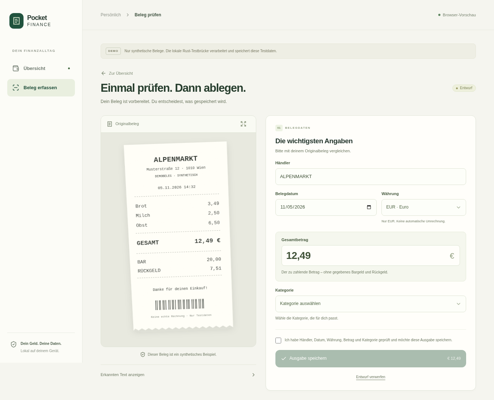

# Pocket Finance Android

A local-first receipt tracker for Android, built with Tauri 2, Svelte 5,
SvelteKit in static SPA mode, TypeScript and shadcn-svelte. Photograph or import
an Austrian receipt, review its fields, and explicitly save an expense locally.

The public app builds without access to a private repository or an AI model.
The optional private `pocket-finance-agent` category provider is a library
substitution, not a dependency of the default public build. It can suggest a
category; Rust and the user remain responsible for amounts and confirmation.



The screenshot shows a synthetic browser fixture, not a phone camera test.

## Receipt workflow

1. Capture a full-resolution image using the Android system camera, or choose
   an existing image using the system Photo Picker. The app retains its own
   private copy and passes a file reference through the bridge.
2. Recognize Latin text on-device with the bundled ML Kit Text Recognition v2
   model. No OCR-model download should be needed at first launch. Physical-device
   airplane-mode verification is reported separately in the verification notes.
3. Rust extracts a draft containing merchant, date, EUR amount and total
   candidates. Amounts such as `12,49 €` become exactly `1249` cents. Tendered
   cash and change are excluded from totals. Ambiguous or missing values remain
   editable and require review.
4. Review the image and fields, choose a category, then tap save. SQLite creates
   one transaction per draft, including when save is retried or tapped twice.
5. The saved expense appears in the transaction list. OCR or model failure does
   not prevent manual entry and saving.

## Repository layout

- `src/`: Svelte mobile UI and an explicitly labelled synthetic browser demo.
- `src-tauri/`: Tauri host, commands and Android app configuration.
- `plugins/receipt-capture/`: native camera, picker, private files and bundled OCR.
- `crates/receipt-core/`: deterministic parsing, validation and SQLite persistence.
- `crates/category-provider/`: public no-model provider with the private adapter's API.
- `docs/`: setup, integration, privacy and verification notes.

Run commands from this repository's root. Generated files go in ignored
`artifacts/` and `target/` directories; no receipt, database or model belongs in Git.

## Development

Install Node.js, npm and the Rust toolchain pinned in `rust-toolchain.toml`.
Android builds also need a JDK, Android SDK/NDK and the Rust Android target; see
[Android setup](docs/ANDROID.md).

```sh
npm ci
npm run check
npm run build
cargo test -p receipt-core --locked
cargo test --manifest-path crates/category-provider/Cargo.toml --locked
npm run dev
```

The ordinary browser view is a clearly labelled synthetic demonstration. It
cannot open the Android camera or establish that native OCR works. See
[verification](docs/VERIFICATION.md) for the real Rust/browser fixture path and
what was actually built or run.

With the Android toolchain configured and your Seeker connected through authorized
USB debugging, build and install a standalone test APK:

```sh
scripts/android-env.sh npm run tauri -- android build --debug --target aarch64 --apk --ci
scripts/android-env.sh adb install -r src-tauri/gen/android/app/build/outputs/apk/universal/debug/app-universal-debug.apk
```

For the first offline acceptance test, enable airplane mode before opening the
app for the first time. This built APK contains the frontend assets; it does not
need the live development server. Public debug and unsigned release builds passed
in this milestone; physical-device behavior remains unverified.

## Optional agent library

The default provider reports unavailable. For a private build, use the documented
[local Cargo patch](docs/PRIVATE-AGENT.md) to select the private library without
publishing its source or making public builds fetch it. A missing or failing
model leaves category selection manual. This milestone does not establish an
Android GGUF runtime or reliable autonomous financial reasoning.

## Privacy, licensing and scope

Receipt images and SQLite records stay in app-private storage. There is no app
account, cloud sync, market feed or hosted inference dependency. Receipt and OCR
content must not enter logs. Read [privacy and SDK behavior](docs/PRIVACY.md),
including the distinction between bundled on-device recognition and SDK telemetry.

Application source is MIT licensed. Third-party dependencies retain their own
licenses; Google's ML Kit SDK has Google's terms and is not represented as MIT
or Google-free. A Google-free OCR backend is outside this milestone.
This first app focuses on receipts and expenses; it does not yet implement a full
banking, investment, budget or document-management product.
