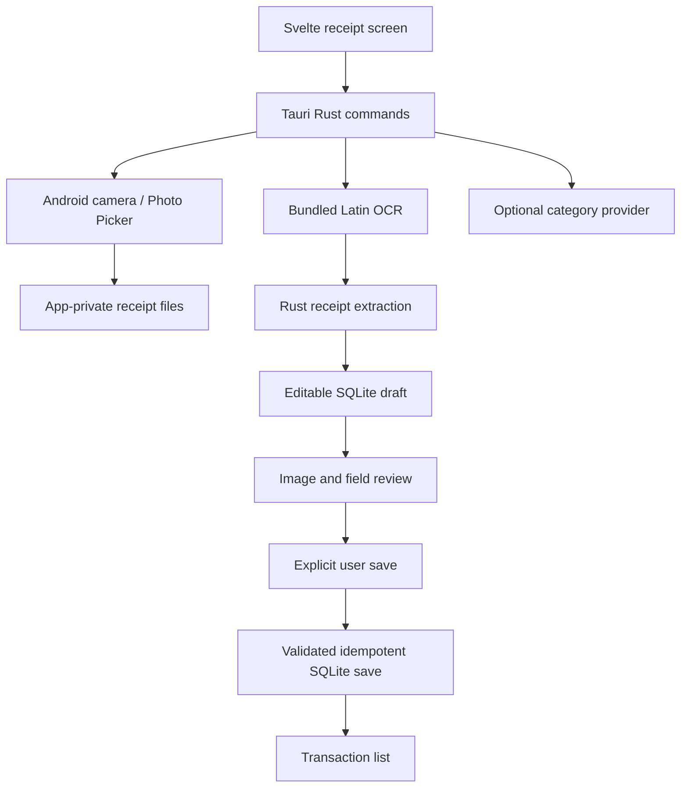

# Receipt architecture

The app is a single Tauri Android application. SvelteKit produces static SPA
assets; there is no Svelte server deployed with the app. The frontend calls a
small set of Rust commands and never opens SQLite, arbitrary filesystem paths or
a model endpoint directly.

## Boundaries

- `receipt-core` contains new public domain code and tests. It has no model or
  native camera dependency and can process fixed synthetic OCR strings.
- The native receipt plugin owns full-resolution files and preview production.
  Only canonical opaque image IDs enter its commands; raw paths and external
  content URIs are not accepted from the frontend.
- The Tauri host binds native results to drafts and owns the database. It executes
  blocking work away from the UI task and resolves previews through a constrained
  local protocol. OCR failures create a manually editable draft.
- The category provider is replaceable at build time. Its public implementation
  returns unavailable; a private implementation with the same narrow API can
  reuse the existing agent backend. No private dependency is fetched by default.
- Save validation checks merchant, ISO date, EUR cents, category and confirmation.
  Persistent draft identity ensures a repeated save creates no second expense.
  The UI marks saving pending and renders success from the database response.

## Scope and correctness

The parser is a conservative heuristic, not a general receipt-understanding
model. It uses total labels and excludes subtotal, tender, change, discount and
tax-only amounts. Distinct credible totals remain candidates. A user can correct
all fields; the reviewed amount is stored as integer cents without floating-point
arithmetic. Unsupported currencies are not converted automatically.

The first milestone records EUR expenses with an internal default account. It
does not reproduce every domain from the older FinanzTracker app. Future accounts,
budgets, investments and receipt search need their own migrations and interfaces.
Actual OCR-image quality and phone lifecycle behavior require device tests.
